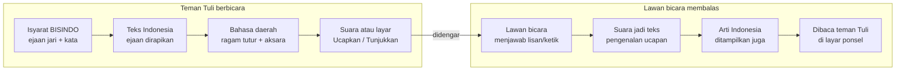

# Proposal BISARA — BUDAYA GO! 2026

12 November 2026 · Lelianto Eko Pradana

> Salinan dari dokumen yang sedang disunting: https://claude.ai/artifact/HWMFeCsxLTauot1H5W64hC. Bila keduanya berbeda, dokumen itu yang berlaku.

## Catatan draf (hapus sebelum dikirim)

Draf ini disusun dari isi repositori per 12 November 2026 (commit `f78c82c`). Struktur memakai format proposal umum karena panduan resmi BUDAYA GO! 2026 belum ada di tangan.

- [ ] Cocokkan struktur, batas halaman, dan kriteria dengan panduan resmi 2026
- [ ] Pilih kategori: Mahasiswa atau Profesional
- [ ] Isi bagian Tim (nama, peran, latar belakang)
- [ ] Isi setiap `[PERLU DATA: ...]` dengan angka bersumber, atau hapus kalimatnya
- [ ] Konfirmasi atau ganti setiap `[ASUMSI]`, terutama mitra komunitas Tuli

**Catatan nama.** BISARA berasal dari BISINDO, bicara, dan aksara. Nama sebelumnya, ISYARA, diganti karena sudah dipakai dua proyek akademik lain: aplikasi penerjemah SIBI dalam [makalah seminar ITI](https://semnas.iti.ac.id/tpx/index.php/c/article/download/389/128/928) dan [Isyara Vision](https://ir.uitm.edu.my/id/eprint/145551/) dari UiTM Malaysia. Pencarian web per 12 November 2026 tidak menemukan produk lain bernama BISARA. Sebelum rilis publik, cek PDKI dan toko aplikasi.

Info lomba yang dipakai berasal dari peluncuran edisi Oktober 2025: tema "Titik Temu Budaya dan Teknologi", kategori Mahasiswa dan Profesional, tahapan seleksi administrasi, pendalaman substansi, pendampingan mentor, dan grand final ([Metro TV News](https://www.metrotvnews.com/read/kpLCaP4Q-kompetisi-budaya-go-titik-temu-budaya-dan-teknologi-untuk-pemajuan-kebudayaan)).

## Judul

**BISARA: BISINDO, Bahasa Daerah, dan Aksara dalam Satu Percakapan**

Aplikasi web berbasis AI yang membaca Bahasa Isyarat Indonesia (BISINDO), menerjemahkannya ke 10 bahasa daerah lengkap dengan aksara Nusantara, mengucapkannya, lalu menampilkan balasan lawan bicara sebagai teks. Namanya dari BISINDO, bicara, dan aksara.

Alternatif judul:

1. BISARA: Titik Temu BISINDO dan Bahasa Daerah
2. BISARA: Jembatan BISINDO, Bahasa Daerah, dan Aksara Nusantara
3. BISARA: Satu Percakapan, Tiga Warisan Bahasa

## Ringkasan eksekutif

BISARA membantu teman Tuli bercakap langsung dengan orang di sekitarnya, dalam bahasa daerah lawan bicaranya. Pengguna berisyarat BISINDO di depan kamera ponsel. Aplikasi membacanya sebagai teks Bahasa Indonesia, menerjemahkannya ke salah satu dari 10 bahasa daerah, menampilkan aksaranya (Jawa, Sunda, atau Bali), lalu mengucapkannya. Balasan lawan bicara lewat suara atau ketikan ditampilkan kembali sebagai teks.

Karya ini mempertemukan tiga warisan bahasa yang jarang dipertemukan: BISINDO, bahasa daerah dengan ragam tuturnya (Ngoko/Krama, Loma/Lemes, Andap/Alus), dan aksara Nusantara. Semua AI berjalan di perangkat pengguna. Tidak ada video yang diunggah, tidak perlu akun, dan tidak ada biaya server.

Prototipe sudah berjalan. Ia mengenali ejaan jari A–Z dan 66 isyarat kata BISINDO. Pada penanda yang tidak pernah dilihat model, isyarat kata dikenali benar 74,4% pada tebakan pertama dan 93,8% dalam tiga saran teratas. Pengguna juga bisa mengajarkan isyarat versinya sendiri dengan tiga rekaman, karena BISINDO punya variasi daerah.

Selama lomba, kami akan memvalidasi isyarat dan kosakata bersama komunitas Tuli dan penutur bahasa daerah, lalu merilis aplikasi yang bisa dipasang dan dipakai tanpa internet.

## Latar belakang dan masalah

Tiga warisan bahasa Indonesia menghadapi masalah yang sama: makin sedikit orang yang bisa memakainya dalam percakapan sehari-hari.

**1. Teman Tuli dan BISINDO.** BISINDO lahir dan tumbuh di komunitas Tuli Indonesia, dengan variasi di tiap daerah. Hanya sedikit orang dengar yang memahaminya. Akibatnya, urusan sederhana seperti berbelanja, bertanya arah, atau berobat sering bergantung pada tulisan di kertas atau juru bahasa isyarat yang jumlahnya terbatas. [PERLU DATA: jumlah penyandang disabilitas rungu di Indonesia dan jumlah juru bahasa isyarat, dari BPS atau Gerkatin]

**2. Bahasa daerah.** Di banyak daerah, percakapan di pasar, warung, dan rumah masih berlangsung dalam bahasa daerah. Teman Tuli yang tinggal di sana tidak hanya terhalang bahasa lisan, tetapi juga bahasa daerah. Di sisi lain, generasi muda makin jarang memakai bahasa daerah, apalagi ragam halusnya seperti Krama. [PERLU DATA: status vitalitas bahasa daerah, dari Badan Bahasa]

**3. Aksara Nusantara.** Aksara Jawa, Sunda, dan Bali masih terpampang di papan nama jalan dan diajarkan di sekolah. Namun sedikit orang yang bisa membacanya dengan lancar, karena jarang dipakai dalam keseharian.

Alat yang ada menyelesaikan masalah ini satu per satu. Ada kamus isyarat, kamus bahasa daerah, dan aplikasi aksara. Belum ada yang membantu teman Tuli bercakap langsung dalam bahasa daerah, dengan cara yang menghormati ragam tutur dan menjaga privasi.

## Keterkaitan dengan pemajuan kebudayaan

BISARA menyentuh dua Objek Pemajuan Kebudayaan dalam UU No. 5 Tahun 2017, yaitu **bahasa** (BISINDO dan 10 bahasa daerah) dan **manuskrip** (lewat aksara Nusantara yang dipakai untuk menulisnya). Karya ini menjalankan keempat langkah pemajuan kebudayaan:

| Langkah (UU 5/2017) | Wujudnya di BISARA |
| --- | --- |
| Pelindungan | Kosakata isyarat, kosakata 10 bahasa daerah, dan ragam tutur didokumentasikan dalam kamus terbuka beserta asal-usul datanya |
| Pengembangan | Model AI pengenal isyarat BISINDO dan mesin terjemahan bahasa daerah dikembangkan dan dievaluasi secara terbuka |
| Pemanfaatan | Bahasa daerah dan aksara dipakai dalam percakapan nyata, bukan hanya dipelajari di kelas |
| Pembinaan | Mode Belajar melatih ejaan jari, isyarat kata, dan aksara; validasi dilakukan bersama komunitas Tuli dan penutur asli |

**Menjawab tema "Titik Temu Budaya dan Teknologi".** Teknologi di sini melayani budaya, bukan menggantikannya. Tiga prinsip kami pegang:

- **Komunitas yang menentukan.** Isyarat dan kosakata yang benar ditentukan komunitas Tuli dan penutur bahasa daerah, bukan model AI.
- **Variasi dihormati.** Pengguna bisa mengajarkan isyarat versinya sendiri, sehingga variasi daerah BISINDO tidak diseragamkan.
- **Makna dijaga.** Ragam tutur hormat (Krama, Lemes, Alus) dipilih sesuai lawan bicara. Bila bentuk halus belum tersedia, aplikasi memberi tanda, bukan menebak.

## Solusi dan cara kerja

Satu layar, "Bicara", menangani percakapan dua arah dari isyarat sampai suara.

Bahasa daerah dan aksara menjadi inti alur: isyarat masuk lewat Bahasa Indonesia, keluar dalam bahasa lawan bicara, dan balasannya kembali dengan arti Indonesianya.

**Skenario.** Rina, seorang Tuli, berbelanja di pasar di Yogyakarta. Pedagangnya sudah sepuh dan lebih nyaman berbahasa Jawa. Rina membuka BISARA di ponsel dan mengarahkan kamera ke tangannya. Ia memperagakan isyarat kata "berapa", lalu mengeja "harga cabai" dengan jari. Karena lawan bicaranya lebih tua, Rina memilih ragam halus. Aplikasi menampilkan kalimatnya dalam bahasa Jawa Krama, lengkap dengan aksara Jawa. Rina menekan **Ucapkan**, dan ponsel membacakannya. Pedagang menjawab dengan suara. Jawabannya muncul di layar Rina sebagai teks beserta arti Bahasa Indonesianya.

**Langkah di balik layar:**

1. **Isyarat ke teks.** Kamera membaca ejaan jari A–Z dan 66 isyarat kata BISINDO. Bila model ragu, ia menawarkan tiga saran untuk dipilih pengguna, bukan menebak.
2. **Merapikan teks.** Mesin ejaan mengembangkan singkatan, memisahkan kata yang menempel, dan membetulkan salah huruf. Setiap perubahan ditampilkan dan bisa dibatalkan.
3. **Terjemahan.** Teks Bahasa Indonesia diterjemahkan ke bahasa daerah pilihan dengan ragam tutur yang sesuai, lalu ditransliterasikan ke aksara.
4. **Suara atau layar.** **Ucapkan** membacakan kalimat. **Tunjukkan** menampilkan teks besar yang bisa diputar 180° agar terbaca lawan bicara di seberang.
5. **Balasan.** Lawan bicara menjawab lewat suara atau ketikan. Jawabannya ditampilkan sebagai teks beserta arti Bahasa Indonesianya.

**Fitur pendukung:**

- **Frasa:** kalimat sehari-hari dan frasa pribadi yang bisa diucapkan sekali ketuk.
- **Belajar:** latihan ejaan jari dan isyarat kata, dengan poin dan progres harian. Pengguna juga bisa mengajarkan isyarat versinya sendiri.
- **Kamus:** alfabet BISINDO dengan asal-usul fotonya, kosakata 10 bahasa daerah, kalimat sejajar, serta panduan aksara (huruf dasar, sandhangan, pasangan) dan filosofinya.

Bahasa daerah yang didukung: Jawa, Sunda, Bali, Madura, Batak Toba, Minangkabau, Bugis, Aceh, Banjar, dan Dayak Ngaju. Bahasa Indonesia menjadi bahasa poros, sehingga terjemahan antar-bahasa daerah juga bisa.

## Kebaruan

Kebaruan utamanya adalah kombinasi: isyarat, bahasa daerah, ragam tutur, dan aksara dalam satu percakapan, berjalan sepenuhnya di perangkat.

| Aspek | Solusi yang umum ada | BISARA |
| --- | --- | --- |
| Bahasa keluaran | Bahasa Indonesia saja | 10 bahasa daerah + Bahasa Indonesia, dengan aksara Jawa, Sunda, dan Bali |
| Ragam tutur | Tidak dibedakan | Ngoko/Krama, Loma/Lemes, Andap/Alus, dengan penanda bila bentuk halus belum ada |
| Arah percakapan | Satu arah (isyarat ke teks) | Dua arah: isyarat ke suara, suara lawan bicara ke teks |
| Variasi isyarat | Satu bentuk baku | Pengguna bisa mengajarkan isyarat versinya sendiri dengan 3 rekaman |
| Ekspresi wajah | Sering diabaikan | Ikut dibaca model (19 titik ekspresi + arah kepala), karena bagian dari tata bahasa isyarat |
| Privasi | Video sering dikirim ke server | Tidak ada video yang keluar dari perangkat |
| Saat model ragu | Menebak satu jawaban | Menawarkan tiga saran untuk dipilih pengguna |

[ASUMSI] Kolom "solusi yang umum ada" adalah gambaran umum. Sebaiknya diganti dengan 2–3 aplikasi pembanding yang disebut namanya setelah dicek tim.

## Teknologi dan hasil evaluasi

Seluruh AI berjalan di browser ponsel atau laptop pengguna. Aplikasi tidak memakai server inferensi, tidak mengunggah gambar atau video, tidak memerlukan akun, dan tidak memakai API berbayar.

**Cara kerjanya, singkat:**

- **Membaca gerak.** MediaPipe menandai titik-titik tangan, tubuh, dan wajah dari kamera. Yang diolah hanya koordinat titik, bukan gambar.
- **Mengenali huruf.** Model *TwoHand v1* membandingkan bentuk dan posisi kedua tangan (254 ciri) dengan contoh huruf A–Z. Huruf baru ditulis setelah stabil di 6 dari 8 bingkai, agar tidak terulang atau salah baca.
- **Mengenali kata.** Model *words-v1* (jaringan saraf temporal) membaca urutan gerak tangan, posisi tubuh, 19 titik ekspresi wajah, dan arah kepala, lalu mengenali 66 kata BISINDO.
- **Belajar dari pengguna.** Isyarat yang diajarkan pengguna disimpan sebagai "sidik" numerik di perangkatnya, lalu dicocokkan dengan isyarat baru.
- **Bahasa dan aksara.** Mesin terjemahan berbasis kamus dan aturan, diperkaya korpus paralel NusaX. Ia mengurai imbuhan, memilih ragam tutur, dan mentransliterasikan ke aksara.

Dibangun dengan React, TypeScript, dan Vite. Kualitas kode dijaga 88 uji unit dan 23 uji ujung-ke-ujung di browser.

**Hasil evaluasi:**

| Kemampuan | Cara uji | Hasil |
| --- | --- | --- |
| Isyarat kata (66 kata) | Penanda yang tidak pernah dilihat saat pelatihan | 74,4% benar pada tebakan pertama; 93,8% dalam 3 saran teratas; penanda kedua 90,9% |
| Isyarat kata pribadi | Simulasi 2 penanda baru, 10 kata × 3 rekaman | 88,9% diterima benar; 0,1% salah; 2,6% kata yang tidak diajarkan salah diterima |
| Pembanding metode lama (DTW) | Skenario yang sama | 77,2% benar; 2,7% salah; 27,1% salah diterima |
| Ejaan jari A–Z | 103 foto uji | 97/103 (94,2%) benar pada tebakan pertama; 86 foto diterima, semuanya benar |

**Batasan hasil ini.** Uji ejaan jari dilakukan per foto, bukan per orang, dan datanya kecil (sekitar 20 foto per huruf). Pada ambang keyakinan 0,7, sekitar 6% isyarat yang tidak dikenal masih salah diterima. Akurasi pada pengguna nyata di berbagai kondisi cahaya dan kamera belum diukur secara sistematis. Pengukuran itu menjadi bagian dari rencana kerja.

## Dampak dan indikator keberhasilan

Keberhasilan diukur dari percakapan yang benar-benar terjadi, bukan dari jumlah unduhan. Semua target di bawah adalah [ASUMSI] awal yang perlu disepakati tim dan mitra komunitas.

| Tingkat | Indikator | Target akhir lomba |
| --- | --- | --- |
| Keluaran | Isyarat kata yang sudah divalidasi juru bahasa atau guru BISINDO Tuli | 66 kata |
| Keluaran | Bahasa daerah yang leksikon intinya diaudit penutur asli | 5 dari 10 bahasa |
| Keluaran | Aksara Nusantara yang didukung | 5 (tambah Lontara dan Surat Batak) |
| Hasil | Akurasi isyarat kata pada uji langsung bersama pengguna Tuli | Diukur dan dipublikasikan, berapa pun hasilnya |
| Hasil | Uji coba percakapan nyata (pasar, layanan publik, sekolah) | 3 lokasi, minimal 20 peserta Tuli |
| Hasil | Peserta yang merasa terbantu (survei pasca-uji) | ≥ 70% |
| Dampak | Kosakata isyarat dan bahasa daerah terdokumentasi dalam kamus terbuka | Dirilis dengan lisensi yang jelas |

Dampak jangka panjangnya adalah dua arah. Teman Tuli lebih mandiri berinteraksi di lingkungannya. Orang dengar dan generasi muda ikut terpapar BISINDO, ragam tutur bahasa daerah, dan aksara lewat aplikasi yang sama.

## Pelibatan komunitas

Kami berpegang pada prinsip *Nothing about us without us*: tidak ada keputusan tentang BISINDO tanpa komunitas Tuli. Hingga kini, referensi isyarat dan leksikon bahasa daerah belum diverifikasi oleh komunitas atau penutur asli. Karena itu, pelibatan komunitas adalah pekerjaan pertama, bukan pelengkap.

1. **Validasi isyarat bersama komunitas Tuli.** Guru BISINDO Tuli atau juru bahasa isyarat meninjau 66 isyarat kata dan foto referensi alfabet, termasuk mencatat variasi daerah. [PERLU DATA: nama mitra, misalnya DPC Gerkatin atau Pusbisindo setempat]
2. **Rekaman isyarat baru dengan persetujuan.** Kosakata ditambah dari rekaman penanda Tuli yang memberi persetujuan tertulis dan mendapat imbalan yang layak. Data ini sekaligus menjadi milik proyek, sehingga tidak bergantung pada dataset berlisensi non-komersial.
3. **Audit bahasa daerah oleh penutur asli.** Penutur atau pengajar bahasa daerah memeriksa kosakata inti dan ragam tutur. Baru Jawa, Sunda, dan Bali yang punya lembar audit awal; tujuh lainnya belum.
4. **Uji coba lapangan.** Teman Tuli mencoba aplikasi dalam percakapan nyata. Masukan mereka menentukan perbaikan berikutnya.
5. **Kredit terbuka.** Kontributor isyarat, penutur, dan peninjau dicantumkan namanya di aplikasi, sesuai persetujuan mereka.

## Keberlanjutan

Biaya operasional aplikasi hampir nol, karena semua AI berjalan di perangkat pengguna. Yang perlu dibiayai hanyalah hosting web statis dan pengembangan lanjutan, sehingga aplikasi bisa tetap gratis untuk teman Tuli.

**Lisensi data menjadi batasan utama.** Model isyarat kata saat ini dilatih dengan dataset WL-BISINDO berlisensi CC BY-NC 4.0, yang melarang pemakaian komersial. Dataset lainnya (BISINDO 40 Kata dan BISINDO Dinamis) berlisensi MIT. Strategi kami:

- Versi publik tetap gratis dan non-komersial, sesuai lisensi.
- Dataset baru direkam bersama komunitas Tuli dengan persetujuan dan imbalan (lihat Pelibatan komunitas). Lisensinya disepakati bersama komunitas.
- Setelah model dilatih ulang dengan data sendiri, layanan untuk lembaga bisa dikembangkan. [ASUMSI] Contohnya pemasangan di loket layanan publik, rumah sakit, sekolah inklusi, dan destinasi wisata budaya.

**Sumber pendanaan yang bisa dijajaki:** hibah kebudayaan pemerintah, program CSR, dan kerja sama dengan pemerintah daerah untuk konten bahasa daerahnya. [ASUMSI] Daftar ini perlu disesuaikan dengan rencana tim.

[ASUMSI] Kode dan kamus akan dirilis terbuka, sehingga komunitas dan peneliti lain bisa ikut menambah bahasa daerah dan aksara. Lisensinya belum ditetapkan.

## Rencana kerja

Pekerjaan disusun mengikuti tahapan lomba. Tanggal menyusul panduan resmi 2026.

1. **Seleksi administrasi.** Prototipe sudah berjalan: alur Bicara, ejaan jari A–Z, 66 isyarat kata, isyarat pribadi, 10 bahasa daerah, dan 3 aksara.
2. **Pendalaman substansi.**
    - Menjalin mitra komunitas Tuli dan penutur bahasa daerah.
    - Memulai validasi 66 isyarat kata dan audit leksikon Jawa, Sunda, dan Bali.
    - Mengukur akurasi pada pengguna nyata.
3. **Pendampingan mentor.**
    - Aplikasi bisa dipasang dan dipakai tanpa internet (PWA).
    - Menambah aksara Lontara (Bugis) dan Surat Batak (Batak Toba).
    - Menambah kosakata isyarat dari rekaman komunitas.
    - Uji coba lapangan di 3 lokasi.
4. **Grand final.** Demo langsung percakapan dua arah, hasil uji lapangan, dan hasil validasi komunitas.
5. **Setelah lomba.**
    - Melatih ulang model dengan data milik proyek.
    - Mengaudit tujuh bahasa daerah lainnya.
    - Menambah mode latihan "Eja Kata" dan kuis aksara.
    - Menyediakan ekspor dan impor data pribadi pengguna.

## Risiko, etika, dan privasi

Risiko terbesar adalah aplikasi dianggap lebih pintar daripada kenyataannya. Karena itu, setiap batasan ditampilkan di aplikasi dan di proposal ini.

| Risiko | Mitigasi |
| --- | --- |
| Isyarat atau label keliru karena belum diverifikasi komunitas Tuli | Validasi oleh guru BISINDO Tuli sebelum rilis; label "eksperimental" tetap tampil sampai terverifikasi |
| Terjemahan bahasa daerah kurang tepat atau ragam tutur keliru | Audit penutur asli; aplikasi menandai bila bentuk halus belum tersedia |
| Model salah menerima isyarat yang tidak dikenal (sekitar 6% pada ambang 0,7) | Di bawah ambang, aplikasi menawarkan saran, bukan menebak; semua perubahan teks bisa dibatalkan |
| Akurasi turun pada kamera, cahaya, atau warna kulit tertentu | Uji pada beragam penanda dan perangkat; panel diagnostik kamera untuk pengguna |
| Baru 66 kata; percakapan masih bergantung pada ejaan jari | Isyarat pribadi, frasa sekali ketuk, dan perluasan kosakata dari rekaman komunitas |
| Belum menerjemahkan kalimat isyarat utuh (tata bahasa BISINDO) | Disampaikan terbuka sebagai batasan; menjadi arah riset lanjutan bersama komunitas |
| Lisensi data non-komersial | Rekam dataset sendiri dengan persetujuan; versi publik tetap non-komersial |
| Suara bahasa daerah bergantung pada browser (Jawa dan Sunda tersedia, lainnya memakai suara Indonesia) | Tombol "Tunjukkan" menampilkan teks besar sebagai alternatif |

**Privasi.** Gambar dan video tidak pernah meninggalkan perangkat. Isyarat pribadi disimpan sebagai angka koordinat, bukan rekaman, dan bisa dihapus kapan saja dari Pengaturan. Aplikasi tidak memerlukan akun.

**Bahasa.** Kami memakai istilah "Tuli" sesuai preferensi komunitas. Aplikasi ini alat bantu, bukan pengganti juru bahasa isyarat.

## Tim

Tema lomba menekankan kolaborasi pelaku budaya dan pelaku teknologi. Karena itu, tim idealnya mencakup kedua sisi, termasuk anggota atau mitra Tuli.

| Nama | Peran | Latar belakang dan kontribusi |
| --- | --- | --- |
| Lelianto Eko Pradana | [PERLU DATA: peran] | [PERLU DATA] |
| [PERLU DATA] | Mitra komunitas Tuli / guru BISINDO | Validasi isyarat dan uji lapangan |
| [PERLU DATA] | Penutur atau ahli bahasa daerah | Audit kosakata dan ragam tutur |
| [PERLU DATA] | [PERLU DATA] | [PERLU DATA] |

## Lampiran untuk tim (tidak ikut dikirim)

### Penilaian mandiri

Kriteria di bawah adalah kriteria umum lomba inovasi digital. Ganti dengan kriteria resmi 2026 begitu tersedia.

| Kriteria | Skor (1–5) | Alasan | Cara memperkuat |
| --- | --- | --- | --- |
| Relevansi budaya | 5 | Tiga warisan bahasa sekaligus: BISINDO, bahasa daerah, aksara | Tunjukkan peta ke UU 5/2017 di slide pertama |
| Kebaruan | 4 | Kombinasi isyarat, ragam tutur, dan aksara jarang ada | Sebut nama 2–3 aplikasi pembanding |
| Kelayakan teknis | 4 | Prototipe berjalan, evaluasi terukur, 111 uji otomatis | Data uji pada pengguna nyata |
| Dampak | 3 | Masalah nyata, tetapi belum ada uji lapangan | Uji coba dengan 20 peserta Tuli sebelum grand final |
| Kolaborasi budaya–teknologi | 2 | Belum ada mitra komunitas Tuli atau penutur yang tercatat | Prioritas pertama: surat dukungan mitra |
| Keberlanjutan | 3 | Biaya rendah, tetapi terikat lisensi non-komersial | Rencana rekam dataset sendiri |

### Pertanyaan tersulit dari juri

1. **"Apakah komunitas Tuli dilibatkan?"** Jawaban jujur: belum dalam validasi; itu langkah pertama rencana kerja. Paling kuat bila sudah ada mitra yang bisa disebut namanya.
2. **"Akurasinya berapa di dunia nyata?"** Sebut 74,4% / 93,8% pada penanda baru, lalu jelaskan bahwa uji langsung bersama pengguna Tuli sedang dijalankan. Jangan mengutip 94,2% tanpa konteks.
3. **"Bukankah BISINDO tidak bisa diterjemahkan kata per kata?"** Benar. Aplikasi ini belum menerjemahkan tata bahasa BISINDO. Ia membantu percakapan praktis lewat isyarat kata, ejaan jari, dan frasa, dengan pengguna yang memegang kendali.
4. **"Bagaimana dengan variasi isyarat antar-daerah?"** Isyarat pribadi dengan 3 rekaman; diuji 88,9% diterima benar. Kamus akan mencatat variasi daerah bersama komunitas.
5. **"Bagaimana bisa berkelanjutan kalau datanya non-komersial?"** Versi publik tetap gratis; dataset milik proyek direkam bersama komunitas dengan persetujuan dan imbalan.

### Naskah demo 3 menit

1. **0:00–0:20 — Masalah.** Satu kalimat tentang teman Tuli di pasar yang pedagangnya berbahasa Jawa.
2. **0:20–1:20 — Bicara.** Isyarat "halo", lalu "berapa" dan eja "harga cabai". Tunjukkan saran kata, pilih ragam Krama, tampilkan aksara Jawa, tekan Ucapkan.
3. **1:20–1:50 — Balasan.** Juri atau rekan menjawab dengan suara; teks dan artinya muncul. Tekan Tunjukkan dan putar layar 180°.
4. **1:50–2:20 — Isyarat pribadi.** Ajarkan satu isyarat baru dengan 3 rekaman, lalu langsung kenali.
5. **2:20–2:40 — Bahasa lain.** Ganti ke Sunda atau Bali, tunjukkan aksaranya.
6. **2:40–3:00 — Penutup.** Mode pesawat menyala dan aplikasi tetap jalan; tutup dengan rencana validasi bersama komunitas.

Catatan: langkah 6 baru bisa setelah PWA offline selesai. Sebelum itu, tunjukkan bahwa tidak ada video yang diunggah.
